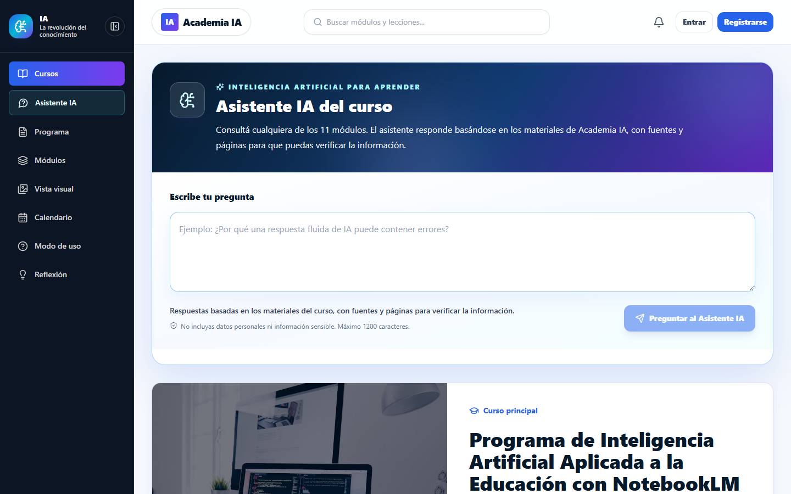
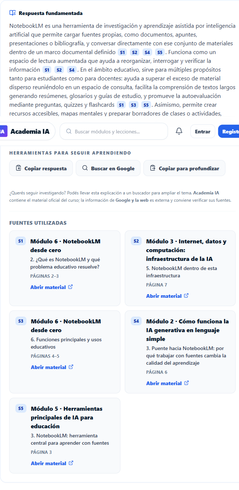
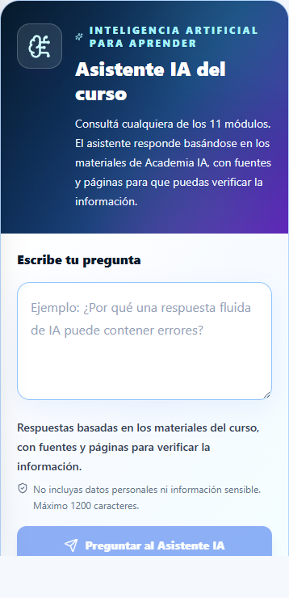
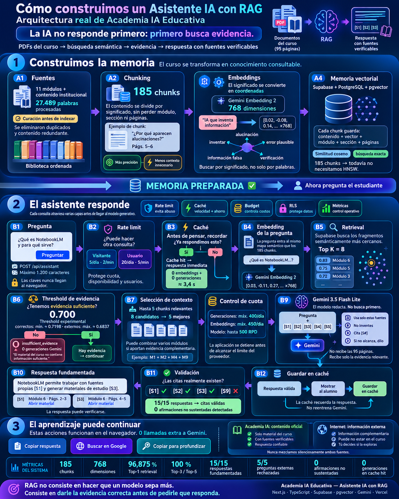
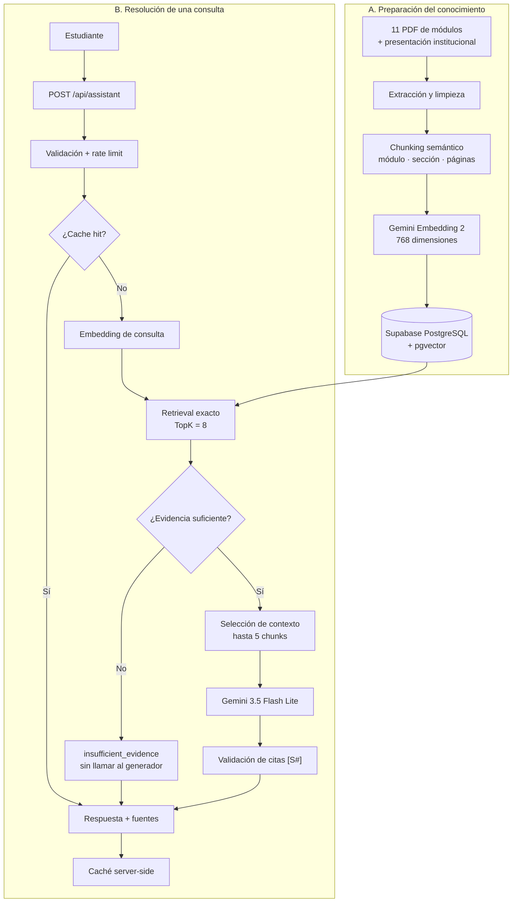

# Academia IA Educativa

**Plataforma educativa Full Stack con Asistente IA basado en RAG, búsqueda semántica, fuentes verificables y control de cuota.**

[](https://nextjs.org/)
[](https://www.typescriptlang.org/)
[](https://supabase.com/)
[](https://ai.google.dev/)
[](https://vercel.com/)

[**Demo en producción**](https://academia-ia-educativa.vercel.app/) · [**Repositorio GitHub**](https://github.com/juansebag31-blip/academia-ia-educativa) · [**Portfolio del autor**](https://portfolio-juan-sebastian.vercel.app/)

---

Academia IA Educativa es una plataforma gratuita en español para aprender inteligencia artificial aplicada a la educación. Su programa principal organiza fundamentos, uso responsable, herramientas educativas y NotebookLM en **11 módulos** con lecciones, actividades, evaluaciones y recursos multimedia.

El proyecto incorpora un Asistente IA que responde exclusivamente con evidencia recuperada de los materiales del curso. Puede buscar por significado, relacionar contenidos de distintos módulos y citar módulo, sección y páginas. Si el corpus no alcanza para sustentar una respuesta, se detiene antes de llamar al modelo generador.

> **La IA no responde primero: primero busca evidencia.**

## Qué problema resuelve

Un chatbot general puede redactar una respuesta convincente sin mostrar de dónde proviene la información. En un entorno educativo eso dificulta verificar conceptos, reconocer los límites del material y distinguir una explicación del curso de conocimiento externo.

El Asistente IA de Academia IA incorpora una cadena de recuperación, validación y citación antes de generar texto:

- responde utilizando únicamente el corpus curado de Academia IA;
- recupera información por similitud semántica, no sólo por palabras exactas;
- combina fragmentos de varios módulos cuando aportan evidencia complementaria;
- devuelve fuentes trazables con módulo, sección, páginas y enlace al material;
- rechaza consultas sin evidencia suficiente;
- reutiliza respuestas validadas mediante caché server-side;
- protege disponibilidad y consumo con rate limiting y presupuestos configurables;
- ofrece acciones de profundización externa sin presentar Internet como contenido oficial del curso.

## Demo visual

### Curso y Asistente IA en escritorio



<table>
  <tr>
    <td width="64%">
      <strong>Respuesta fundamentada, acciones y fuentes</strong><br><br>
      
    </td>
    <td width="36%">
      <strong>Experiencia móvil</strong><br><br>
      
    </td>
  </tr>
</table>

Las capturas corresponden a la aplicación pública. La respuesta mostrada conserva identificadores `[S#]`, tarjetas de fuentes y enlaces para abrir el material citado.

## Cómo construimos un Asistente IA con RAG — Arquitectura real de Academia IA Educativa



> RAG no consiste en hacer que un modelo sepa más. Consiste en darle la evidencia correcta antes de pedirle que responda.

## Arquitectura RAG



### A. Preparación del conocimiento

El pipeline local mantiene separado el corpus RAG del flujo histórico de extracción. Toma como fuente canónica los PDF individuales de los 11 módulos y utiliza `src/lib/course-seed.ts` como autoridad para la metadata. Del cuadernillo institucional sólo conserva contenido general exclusivo, evitando indexar de nuevo los módulos completos.

1. Extrae texto y conserva documento, módulo y página.
2. Limpia encabezados, pies repetidos y cortes artificiales sin eliminar contenido educativo útil.
3. Organiza bloques por módulo, sección, subtítulo y párrafo.
4. Divide sólo las secciones largas y mantiene trazabilidad mediante metadata y hashes.
5. Genera embeddings de documentos con Gemini y los persiste en pgvector.

| Dato del corpus | Valor verificado |
| --- | ---: |
| Módulos | 11 |
| Documentos | 11 módulos + 1 presentación institucional |
| Palabras procesadas | 27.489 |
| Chunks | 185 |
| Modelo de embeddings | `gemini-embedding-2` |
| Dimensiones | 768 |
| Recuperación | similitud coseno exacta en PostgreSQL + pgvector |

Con 185 chunks, la búsqueda exacta es simple, auditable y suficiente. El esquema no añade HNSW ni IVFFlat antes de que el volumen justifique esa complejidad.

### B. Resolución de una consulta

1. El Route Handler valida el método, el JSON, el curso permitido y la longitud de la pregunta.
2. Una identidad seudónima o autenticada pasa por límites configurables de frecuencia y uso diario.
3. La caché busca una coincidencia exacta normalizada, ligada a las versiones de corpus, modelos, prompt y configuración de retrieval.
4. Si no existe una respuesta cacheada, se genera el embedding de consulta.
5. Supabase recupera los **8** vecinos con mayor similitud del curso.
6. Un umbral de suficiencia top-1, actualmente **0.700 y todavía experimental**, decide si existe evidencia mínima.
7. Si la evidencia es insuficiente, devuelve `insufficient_evidence` y **no llama al modelo generador**.
8. Si es suficiente, selecciona hasta **5** chunks relevantes, evita duplicados cercanos y permite combinar módulos.
9. Gemini recibe sólo esos fragmentos identificados como `[S1]`, `[S2]`, etc.
10. La salida se valida para impedir citas inexistentes y se devuelve junto con metadata de fuentes.
11. Las respuestas válidas y los rechazos por evidencia insuficiente pueden almacenarse en caché.

## Chatbot simple frente a Academia IA RAG

| Chatbot simple | Academia IA RAG |
| --- | --- |
| `pregunta → LLM → respuesta` | `pregunta → evidencia → retrieval → validación → LLM → citas` |
| El modelo puede completar con conocimiento general. | El prompt prohíbe salir del contexto recuperado. |
| No necesariamente muestra fuentes verificables. | Cada respuesta enlaza módulos, secciones y páginas. |
| Siempre intenta responder. | Puede detenerse con `insufficient_evidence`. |
| Prioriza producir texto. | Prioriza trazabilidad y grounding. |

El objetivo no es que la respuesta sólo suene correcta, sino que el alumno pueda comprobar qué material la sustenta.

## Decisiones de diseño

- **Corpus curado.** Los PDF modulares son la fuente canónica. Evitar duplicar el cuadernillo completo reduce el riesgo de sesgar el ranking hacia contenido repetido.
- **Chunking semántico.** Los límites respetan módulo, sección, subtítulo, página y párrafo para conservar unidades educativas completas y citables.
- **Embeddings de documentos y consultas.** La preparación textual distingue ambos usos y permite recuperar por significado, incluso cuando la pregunta usa otro vocabulario.
- **Búsqueda vectorial exacta.** Con 185 chunks no existe una razón técnica para aceptar la pérdida aproximada ni la complejidad operativa de HNSW/IVFFlat.
- **Threshold de evidencia.** El corte experimental evita generar cuando el primer resultado no ofrece sustento suficiente; debe seguir calibrándose con preguntas reales.
- **Contexto limitado y diverso.** Gemini no recibe el curso completo: recibe hasta cinco fragmentos relevantes y no duplicados, incluidos varios módulos si se complementan.
- **Citas validadas.** El prompt exige `[S#]` en cada bloque sustantivo y la capa posterior rechaza identificadores que no fueron proporcionados.
- **Caché versionada.** Una pregunta normalizada sólo reutiliza la respuesta si coinciden curso, contexto de módulo, corpus, modelos, prompt y parámetros de retrieval.
- **Rate limiting y presupuestos.** Las operaciones atómicas en Supabase protegen un runtime serverless frente a ráfagas, abuso y agotamiento de cuota.
- **Proveedores desacoplados.** Embeddings y generación dependen de interfaces internas; cambiar el generador no obliga a reconstruir la lógica RAG.

## Evaluación

Estas métricas corresponden a una **batería interna y reproducible del corpus de Academia IA**. No se presentan como benchmarks universales de los modelos ni como garantía sobre preguntas futuras.

### Retrieval

| Métrica | Resultado |
| --- | ---: |
| Consultas evaluadas | 40 |
| Consultas respondibles | 32 |
| Consultas externas | 8 |
| Top-1 accuracy | 96,875 % |
| Top-3 recall | 100 % |
| Top-5 recall | 100 % |

Las consultas respondibles incluyeron preguntas literales, paráfrasis, relaciones entre conceptos y formulaciones ambiguas. Las externas se evaluaron aparte: tener un vecino vectorial no convierte una consulta fuera del corpus en respondible.

### Generación fundamentada

- **15/15** preguntas respondibles contestadas.
- **5/5** preguntas externas rechazadas antes de generar.
- **15/15** respuestas con citas válidas.
- **0** afirmaciones no sustentadas detectadas en la auditoría contra los chunks enviados.

### Benchmark del modelo generador

Se compararon modelos manteniendo iguales el corpus, los embeddings, retrieval, threshold, selección de contexto, prompt y contrato estructurado. `gemini-3.5-flash-lite` fue seleccionado para producción:

- 15/15 respuestas válidas;
- 5/5 consultas externas rechazadas;
- 0 afirmaciones no sustentadas;
- 0 citas inválidas;
- 0 reintentos generativos en esa corrida de evaluación.

Los resultados completos y auditables viven en `content/generated/rag-generation-benchmark-*.json` y `content/generated/rag-generation-benchmark-comparison.json`.

### Caché en producción

Una pregunta repetida validada en producción devolvió la misma respuesta y sus fuentes con:

- **0 embeddings nuevos**;
- **0 generaciones nuevas**.

La caché almacena hashes y la respuesta pública validada, no el texto original de la pregunta.

## Profundización externa

Después de una respuesta `answered`, el alumno dispone de tres acciones:

- **Copiar respuesta:** lleva al portapapeles la explicación con sus referencias.
- **Buscar en Google:** abre una consulta breve derivada de la pregunta original.
- **Copiar para profundizar:** prepara un texto estructurado para continuar investigando y abre el buscador.

Estas acciones funcionan en el cliente. No vuelven a invocar `/api/assistant`, no generan embeddings y no llaman a Gemini. La interfaz indica expresamente que Academia IA contiene el material oficial del curso y que Google o la web aportan información externa que debe verificarse.

## Stack técnico

Versiones instaladas verificadas en el checkout documentado:

| Capa | Tecnologías |
| --- | --- |
| Frontend | Next.js 15.5.19 (App Router), React 19.2.7, TypeScript 5.9.3, Tailwind CSS 3.4.19 |
| Backend | Next.js Route Handlers y lógica server-only, Supabase SSR 0.12.0, Supabase JS 2.108.1 |
| IA | `@google/genai` 2.27.0, `gemini-embedding-2`, `gemini-3.5-flash-lite` |
| Datos | Supabase PostgreSQL, extensión pgvector, SQLite + Drizzle para datos locales del catálogo |
| Infraestructura | Vercel, Supabase y Supabase Storage |
| Calidad | Vitest 2.1.9, Testing Library, jsdom, ESLint 9, TypeScript |

## Seguridad y control de recursos

- `GEMINI_API_KEY`, `SUPABASE_SECRET_KEY` y los secretos HMAC se usan exclusivamente del lado servidor.
- No existe ni debe crearse una variable `NEXT_PUBLIC_GEMINI_API_KEY`.
- Las tablas RAG, de caché, métricas y control de cuota tienen RLS y no son accesibles directamente para los roles cliente.
- El backend utiliza la Secret Key de Supabase; la interfaz nunca recibe embeddings ni credenciales administrativas.
- La API valida forma, longitud, curso y módulo de cada solicitud.
- Los visitantes se identifican con una sesión y una señal seudonimizada mediante HMAC; no se almacena la IP en texto claro.
- Los límites diarios, por minuto y los presupuestos globales son configurables sin publicarlos como parte del contrato de la API.
- Los errores públicos están sanitizados: no incluyen stack traces, prompts internos ni mensajes sensibles del proveedor.
- Las métricas técnicas no necesitan guardar el texto de las preguntas.
- La profundización web permanece separada del contenido oficial y se ejecuta sólo por acción explícita del usuario.

## Estructura relevante

```text
src/
├─ app/
│  ├─ (app)/courses/                 # Curso, módulos y ubicación del asistente
│  └─ api/assistant/                 # Contrato HTTP server-only
├─ components/rag/                   # Interfaz del tutor y acciones externas
└─ lib/rag/                          # Corpus, embeddings, retrieval, grounding y protección
scripts/
├─ prepare-rag-corpus.ts             # Extracción, limpieza, chunking y validación
├─ index-rag-corpus.ts               # Indexación idempotente
├─ evaluate-rag-retrieval.ts         # Evaluación de recuperación
├─ evaluate-rag-generation.ts        # Evaluación de respuestas fundamentadas
└─ benchmark-rag-generation-model.ts # Comparación reproducible de generadores
content/generated/
├─ rag-chunks.json                   # Representación auditable del corpus
└─ rag-*-evaluation.json             # Resultados de evaluación
supabase/migrations/                 # pgvector, funciones, RLS, caché y cuotas
docs/images/                         # Capturas del producto e infografía aprobada
```

## Desarrollo local

### Requisitos

- Git.
- Node.js 20 o superior recomendado.
- npm.
- Un proyecto Supabase y una clave Gemini para probar el RAG extremo a extremo.

### Instalación

```powershell
git clone https://github.com/juansebag31-blip/academia-ia-educativa.git
Set-Location academia-ia-educativa
npm install
Copy-Item .env.example .env.local
npm run dev
```

La aplicación queda disponible en [http://localhost:3000](http://localhost:3000). El acceso base al curso funciona sin registro; las funciones remotas requieren sus variables correspondientes.

### Scripts disponibles

```powershell
npm run dev                       # Servidor de desarrollo
npm run build                     # Build de producción
npm run start                     # Servir el build
npm run lint                      # ESLint
npm test                          # Suite Vitest
npm run test:watch                # Vitest en modo watch
npm run content:prepare:rag       # Generar corpus RAG auditable
npm run content:validate:rag      # Validar corpus sin reescribirlo
npm run rag:smoke                 # Prueba vectorial mínima
npm run rag:index                 # Indexar el corpus completo
npm run rag:evaluate              # Evaluar retrieval
npm run rag:evaluate:generation   # Evaluar generación fundamentada
npm run rag:benchmark:generation  # Benchmark de modelo generador
npm run rag:audit:generation-models
```

Los comandos que acceden a Gemini o Supabase consumen recursos reales. No deben ejecutarse como parte de una instalación básica ni sin configurar primero un entorno controlado.

## Variables de entorno

`.env.example` es la fuente de nombres y alcance. Copia ese archivo a `.env.local` y completa sólo los valores necesarios. Nunca versiones `.env.local`.

### Supabase

| Variable | Alcance | Uso |
| --- | --- | --- |
| `NEXT_PUBLIC_SUPABASE_URL` | Pública | URL del proyecto Supabase |
| `NEXT_PUBLIC_SUPABASE_PUBLISHABLE_KEY` | Pública | Clave publicable para funciones cliente permitidas |
| `SUPABASE_SECRET_KEY` | **Secreta, server-only** | Operaciones administrativas del backend |

### Gemini

| Variable | Alcance | Uso |
| --- | --- | --- |
| `GEMINI_API_KEY` | **Secreta, server-only** | Embeddings y generación fundamentada |
| `GEMINI_RAG_MODEL` | Server-only | Modelo generador configurable |

### RAG y protección de cuota

| Variable | Alcance | Uso |
| --- | --- | --- |
| `RAG_SIMILARITY_THRESHOLD` | Server-only | Umbral experimental de evidencia |
| `RAG_RATE_LIMIT_SECRET` | **Secreta, server-only** | HMAC para identidades seudónimas |
| `RAG_ANONYMOUS_DAILY_LIMIT` | Server-only | Límite configurable para visitantes |
| `RAG_AUTHENTICATED_DAILY_LIMIT` | Server-only | Límite configurable para cuentas |
| `RAG_ANONYMOUS_MINUTE_LIMIT` | Server-only | Protección configurable contra ráfagas anónimas |
| `RAG_AUTHENTICATED_MINUTE_LIMIT` | Server-only | Protección configurable contra ráfagas autenticadas |
| `RAG_DAILY_GENERATION_BUDGET` | Server-only | Presupuesto global de generación |
| `RAG_DAILY_EMBEDDING_BUDGET` | Server-only | Presupuesto global de embeddings |
| `RAG_CACHE_TTL_SECONDS` | Server-only | Vigencia de la caché exacta normalizada |
| `RAG_ASSISTANT_API_ENABLED` | Server-only | Habilitación explícita del endpoint |

### Aplicación y servicios opcionales

| Variable | Alcance | Uso |
| --- | --- | --- |
| `NEXT_PUBLIC_APP_URL` | Pública | URL canónica de la aplicación |
| `NEXT_PUBLIC_CONTACT_EMAIL` | Pública | Contacto mostrado en privacidad |
| `MARKETING_HASH_SECRET` | **Secreta, server-only** | Hashes del flujo de marketing |
| `MARKETING_DOWNLOAD_SECRET` | **Secreta, server-only** | Firma de descargas |
| `RESEND_API_KEY` | **Secreta, server-only y opcional** | Envío de correo |
| `RESEND_FROM_EMAIL` | Server-only y opcional | Remitente autorizado |

## Testing y trazabilidad

La suite automatizada cubre:

- extracción, estructura y hashes del corpus;
- dimensiones de embeddings, persistencia y búsqueda vectorial;
- selección de contexto, threshold y citas;
- API pública y sanitización de errores;
- interfaz, ubicación del asistente y acciones externas;
- rate limiting, presupuestos y métricas;
- cache hit e invalidación por versión/configuración;
- autenticación, progreso, cursos, evaluaciones, marketing y SEO.

Los artefactos de evaluación se versionan para que las métricas del README puedan contrastarse con casos, resultados y fuentes. La verificación de documentación no llama a Gemini ni reindexa el corpus.

**Estado verificado de este checkpoint:** las 7 suites relacionadas con RAG, API e interfaz pasan con 63/63 pruebas y ESLint finaliza sin errores. El chequeo TypeScript global conserva cinco errores históricos en tests de AI Engineering y marketing; no pertenecen al RAG ni fueron introducidos por esta documentación.

## Roadmap

- [x] Corpus curado, extracción y chunking semántico.
- [x] Embeddings y metadata trazable.
- [x] PostgreSQL + pgvector y retrieval exacto.
- [x] Generación fundamentada y citas verificables.
- [x] API y experiencia de chat responsive.
- [x] Caché, rate limiting y presupuestos globales.
- [x] Primera versión en producción.
- [x] Profundización externa client-side.
- [ ] Evaluación con usuarios reales.
- [ ] Mejoras de retrieval y experiencia basadas en feedback.
- [ ] Búsqueda web integrada opcional, sólo si aporta valor y mantiene clara la separación de fuentes.

## Autor

**Juan Sebastián González**

[Portfolio profesional](https://portfolio-juan-sebastian.vercel.app/) · [GitHub](https://github.com/juansebag31-blip)
